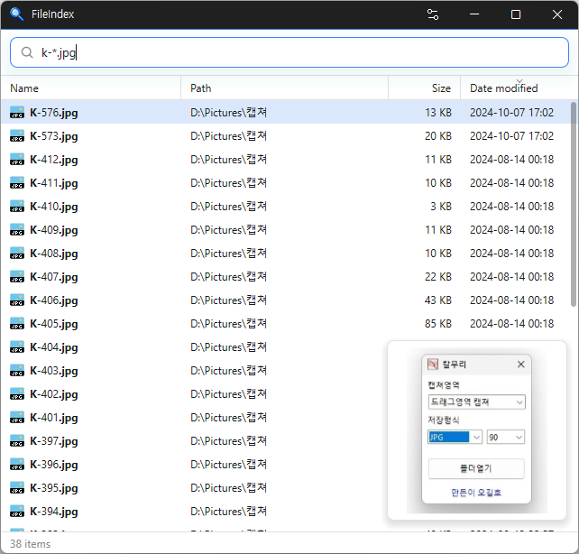

# FileIndex

**Buscador de archivos gratuito para Windows que encuentra archivos en todo el PC en cuanto escribe un nombre.**

[English](README.md) · [한국어](README.ko.md) · [简体中文](README.zh-CN.md) · [日本語](README.ja.md) · Español · [Português (Brasil)](README.pt-BR.md) · [Français](README.fr.md)

> Este documento es una traducción. Si hay alguna diferencia, la [versión en coreano](README.ko.md) es la que prevalece.

-0078D4)

[](https://down.kilho.net/fileindex?lang=es)



## Descripción general

FileIndex busca por nombre de archivo en todas las unidades del PC a la vez. Los resultados cambian mientras escribe en el cuadro de búsqueda, y los nombres en coreano se pueden encontrar escribiendo solo sus consonantes iniciales (`ㅅㅈ` → 설정).

La primera vez que se ejecuta crea una lista de los archivos de cada unidad; a partir de ahí sigue en tiempo real los archivos que se crean, eliminan o cambian de nombre, de modo que los resultados siempre están al día. Puede combinar condiciones de extensión, tamaño, comodines y expresiones regulares, y también encuentra archivos duplicados con el mismo nombre, tamaño o contenido.

Los archivos encontrados se pueden abrir, copiar, arrastrar y usar con el menú contextual igual que en el Explorador de archivos. Al cerrar la ventana, FileIndex se queda en la bandeja del sistema, listo para volver al instante, y mientras está oculto apenas usa memoria.

## Características

- **Búsqueda mientras escribe** — encuentra nombres que contienen todas las palabras separadas por espacios. No distingue mayúsculas de minúsculas.
- **Búsqueda por consonantes iniciales coreanas** — con solo escribir `ㅅㅈ` encuentra nombres como "설정" o "사진".
- **Condiciones de búsqueda** — extensión (`ext:`), tamaño (`size:`), comodines (`*` `?`), expresiones regulares (`regex:`).
- **Buscador de duplicados** — mismo nombre (`dupe:name`), mismo tamaño (`dupe:size`), contenido idéntico (`dupe:content`).
- **Actualización en tiempo real** — los cambios en los archivos aparecen enseguida en los resultados. Los cambios hechos mientras FileIndex estaba cerrado se ponen al día al iniciarlo.
- **Indexación automática de unidades USB** — las unidades recién conectadas se indexan solas y desaparecen de los resultados al quitarlas.
- **Funciona como el Explorador** — doble clic para abrir, abrir la ubicación, selección múltiple y copia, arrastrar al Explorador, menú contextual del Explorador.
- **Vista previa** — muestra junto a la lista la miniatura del archivo seleccionado (fotos, vídeos, PDF, documentos de Office y más).
- **Orden y resaltado** — ordena por nombre, ruta, tamaño o fecha de modificación; la parte del nombre que coincide se resalta.
- **Vive en la bandeja** — al cerrar la ventana se oculta en la bandeja, donde apenas usa memoria.
- **Se queda en su PC** — la lista de archivos se guarda solo en su propio PC.
- **22 idiomas, temas claro y oscuro** — sigue la configuración de Windows de forma predeterminada, o puede elegirlos usted.

## Descarga / instalación

| Tipo | Enlace |
|---|---|
| Instalador | [Descargar](https://down.kilho.net/fileindex?lang=es) |
| Portátil (ZIP) | [Descargar](https://down.kilho.net/fileindex?lang=es&nosetup) |

El instalador abre FileIndex al terminar y activa **Ejecutar al inicio**, de modo que se inicia en la bandeja cada vez que inicia sesión en Windows. Para la versión portátil, descomprima el ZIP y ejecute `FileIndex.exe`. Ambas versiones tienen las mismas funciones.

Leer unidades completas con rapidez requiere permisos de administrador, así que Windows muestra una ventana de confirmación de administrador al iniciar FileIndex. Haga clic en **Sí**.

## Uso

### Primeros pasos

1. Ejecute FileIndex. La primera vez, mientras crea la lista de archivos de cada unidad, el centro de la ventana muestra el progreso, por ejemplo **C: indexando 42%**. Al terminar aparece la pantalla de búsqueda.
2. Escriba parte de un nombre de archivo en el cuadro de búsqueda. Los resultados aparecen en la lista mientras escribe, y abajo se muestra cuántos se encontraron.
3. Haga **doble clic** en el archivo que quiera, o selecciónelo con las flechas y pulse **Enter**, para abrirlo con su programa asociado. Pulse **Ctrl+Enter** para abrir la carpeta que lo contiene.
4. Cuando termine, haga clic en el botón de cerrar (X) o pulse **Esc**. FileIndex no se cierra: se oculta en la bandeja. Haga clic en el icono de la bandeja para que vuelva al instante.

A partir de la segunda ejecución, FileIndex reutiliza la lista ya creada y solo se pone al día con lo que cambió mientras estaba cerrado, así que puede buscar de inmediato.

### Elementos de la pantalla

| Elemento | Función |
|---|---|
| Cuadro de búsqueda | Escriba un nombre de archivo, consonantes iniciales o condiciones de búsqueda. El botón de flecha de la derecha vuelve a buscar con el texto actual |
| Lista de resultados | **Nombre** · **Ruta** · **Tamaño** · **Fecha de modificación**. Haga clic en un encabezado para ordenar; arrastre un borde para cambiar el ancho de una columna |
| Vista previa | Abajo a la derecha de la lista. Miniatura del archivo seleccionado (se oculta en archivos sin miniatura) |
| Barra de estado | Número de resultados. Si hay más que el máximo de resultados, muestra mostrados / total, p. ej. `200 / 14,092 elementos` |
| Botón de configuración | En la barra de título, a la izquierda del botón de minimizar. Abre la ventana **Configuración** |
| Icono de la bandeja | Clic izquierdo para abrir la ventana. El menú contextual tiene **FileIndex** · **Autor** · **Salir** |

### Casos de uso

**Encontrar nombres coreanos por sus consonantes iniciales**
Escribiendo solo consonantes coreanas se encuentran los nombres cuyas iniciales aparecen en ese orden. `ㄱㅇㅅ` encuentra nombres como "계약서" y "계약서_수정본", cuyas iniciales contienen ㄱ, ㅇ, ㅅ en secuencia. Incluso los nombres largos se encuentran con unas pocas teclas.

**Acotar con varias palabras**
Separe las palabras con espacios y solo quedarán los nombres que las contienen todas. `informe 2026` encuentra archivos que tienen "informe" y "2026" en el nombre. El orden de las palabras no importa.

**Buscar solo ciertos tipos de archivo**
Escriba las extensiones después de `ext:`, separadas por **punto y coma (;)**. Las carpetas se excluyen; solo aparecen archivos.
- `ext:pdf` — todos los archivos PDF
- `ext:jpg;png;gif viaje` — imágenes con "viaje" en el nombre

**Encontrar archivos grandes para liberar espacio**
Use `size:` para una condición de tamaño. Las unidades son `b` `kb` `mb` `gb` `tb`; sin unidad, son bytes.
- `size:>1gb` — archivos de más de 1 GB
- `size:1mb-5mb` — de 1 MB a 5 MB, ambos incluidos (`1mb..5mb` también sirve)
- `ext:mp4 size:>500mb` — vídeos de más de 500 MB

Ordene los resultados por el encabezado **Tamaño** para ver primero los archivos más grandes.

**Ajustar la forma de un nombre con comodines**
`*` equivale a cualquier cantidad de caracteres y `?` a exactamente uno. Con comodines, **el nombre completo** debe coincidir con el patrón.
- `*.txt` — archivos con extensión txt
- `readme*` — nombres que empiezan por readme
- `IMG_????.jpg` — imágenes con cuatro caracteres después de IMG_

**Buscar con más precisión con expresiones regulares**
Escriba una expresión regular después de `regex:`. No distingue mayúsculas de minúsculas y puede coincidir en cualquier parte del nombre. Use `^` y `$` para fijar el inicio y el final; como los espacios separan los términos de búsqueda, escriba un espacio dentro del patrón como `\s`.
- `regex:^\d{8}` — nombres que empiezan por ocho dígitos (como una fecha)
- `regex:(draft|final)` — nombres que contienen draft o final

Si una condición está mal escrita, la barra de estado muestra un ejemplo de la forma correcta.

**Limpiar archivos duplicados**
`dupe:` agrupa los archivos coincidentes y los muestra grupo por grupo. Combinado con otras condiciones, solo compara dentro de esos resultados.
- `dupe:name` — archivos con el mismo nombre (sin distinguir mayúsculas)
- `dupe:size ext:jpg` — imágenes del mismo tamaño
- `dupe:content ext:mp4` — vídeos con **exactamente el mismo contenido**

`dupe:content` lee de verdad los archivos para compararlos, así que la barra de estado muestra el progreso como **Comparando contenido — archivos n/N, x/y MB**. Si cambia el texto de búsqueda, la comparación se detiene. En cada grupo, seleccione todo salvo la copia que quiera conservar y luego clic derecho → Eliminar.

**Encontrar un archivo recién descargado**
El orden predeterminado es **Fecha de modificación**, de más reciente a más antiguo, así que con escribir parte de un nombre el archivo descargado o editado más recientemente queda arriba. Los archivos nuevos o recién guardados aparecen enseguida en los resultados.

**Demasiados resultados / quiere verlos todos**
De forma predeterminada la lista muestra hasta **200** resultados. La búsqueda siempre abarca todo, lo ordena y muestra desde el principio, así que obtiene "los 200 más recientes" o "los 200 más grandes". `200 / 14,092 elementos` en la barra de estado significa que se muestran 200 de 14.092 resultados. Para ver más, aumente **Configuración → Resultados máx.**

**Copiar o mover varios archivos a otro sitio**
- Seleccione varios con **Ctrl/Mayús + clic** o **Mayús + flechas**, o pulse **Ctrl+A** para seleccionar todos los resultados.
- Pulse **Ctrl+C** y pegue en el Explorador de archivos.
- También puede **arrastrar los archivos seleccionados al Explorador o al escritorio**. Igual que en el Explorador, se mueven dentro de la misma unidad y se copian a otra unidad.

**Usar el menú contextual del Explorador**
Haga clic derecho en un resultado para obtener el mismo menú que en el Explorador (Abrir con, Enviar a, comprimir, Eliminar, Propiedades, etc.). Mantenga **Mayús** al hacer clic derecho para ver también los comandos extendidos. Los programas iniciados desde este menú se ejecutan con permisos normales de usuario, no como administrador.

**Ver fotos y documentos sin abrirlos**
Con **Vista previa** activada (opción predeterminada), cada vez que selecciona un archivo aparece una miniatura abajo a la derecha de la lista. Es la misma miniatura que muestra el Explorador, así que se previsualizan vídeos, PDF y documentos de Office además de fotos. Recórralos con las flechas.

**Buscar en memorias USB y discos externos**
Conecte uno y en pocos segundos se indexa y aparece en los resultados. Al desconectarlo, sus resultados desaparecen; al volver a conectarlo, se indexa de nuevo.

**Solo con el teclado**
El foco siempre está en el cuadro de búsqueda, así que basta con escribir.

| Tecla | Acción |
|---|---|
| ↑ ↓ / RePág AvPág | Seleccionar resultados (mantenga Mayús para seleccionar un rango) |
| Enter | Abrir con el programa asociado (el primer resultado si no hay selección) |
| Ctrl+Enter | Abrir la ubicación del archivo en el Explorador |
| Ctrl+A / Ctrl+C | Seleccionar todos los resultados / copiar los archivos seleccionados |
| Esc | Borrar el texto de búsqueda; si ya está vacío, ocultar en la bandeja |

**Abrir una búsqueda desde un acceso directo o un script**
Indique una búsqueda después de `--search` (o `-s`) y FileIndex se abre con esos resultados. Si FileIndex ya está en marcha, la ventana abierta hace esa búsqueda.

```
FileIndex.exe --search "ext:pdf contrato"
FileIndex.exe -s "*.psd"
```

Añádalo al destino de un acceso directo del escritorio para abrir una búsqueda frecuente con un clic.

**Dejarlo en marcha y usarlo como un atajo**
Con **Ejecutar al inicio** activado, FileIndex se inicia en la bandeja sin ventana al iniciar sesión. Haga clic en el icono de la bandeja cuando lo necesite: aparece con el cursor ya en el cuadro de búsqueda, así que solo tiene que escribir. Para cerrarlo del todo, clic derecho en el icono de la bandeja → **Salir**.

## Configuración

Abra **Configuración** con el botón de configuración de la barra de título. Los cambios se guardan y se aplican al instante.

| Sección | Opción | Predeterminado |
|---|---|---|
| General | Orden predeterminado (Por nombre · Por ruta · Por tamaño · Por fecha de modificación) | Por fecha de modificación |
| General | Tema (Sistema · Claro · Oscuro) | Sistema |
| General | Idioma (Sistema + 22 idiomas) | Sistema |
| General | Resultados máx. | 200 |
| General | Vista previa | Activada |
| General | Ejecutar al inicio | Activado en la versión con instalador |
| Acerca de | Versión · Autor · Sitio web · Licencia | — |

**[Restablecer]** devuelve la configuración a sus valores predeterminados y además desactiva Ejecutar al inicio. La lista de archivos ya creada se conserva. Al cambiar el idioma, la pantalla pasa a ese idioma al momento, sin reiniciar.

## Requisitos

- Windows 10 · Windows 11 (64 bits)
- Unidades con formato NTFS (el formato predeterminado de Windows — tanto discos internos como unidades USB)
- Permisos de administrador (haga clic en **Sí** en la confirmación al iniciar)
- Internet solo se usa para comprobar si hay versiones nuevas. La búsqueda funciona sin conexión.

## Actualizaciones

FileIndex **no** se actualiza solo. Al iniciarse comprueba si hay una versión nueva y muestra un aviso; al hacer clic en **[Sí]** abre la página de descarga y cierra el programa. Las versiones nuevas se publican manualmente tras pruebas internas y se anuncian en la [página de FileIndex](https://kilho.net/fileindex). Consulte el [aviso sobre la política de actualizaciones](https://en.kilho.net/archives/notice/2940).

## Licencia

FileIndex es **freeware**. Úselo gratis en cualquier lugar —en la oficina, en casa, en organismos públicos o en la escuela— y redistribúyalo libremente.

## Enlaces

- Sitio web: <https://kilho.net/fileindex>
- Foro: <https://kilho.top/forum/qna>
- X (Twitter): <https://www.twitter.com/kilhonet>

© KILHO.NET
