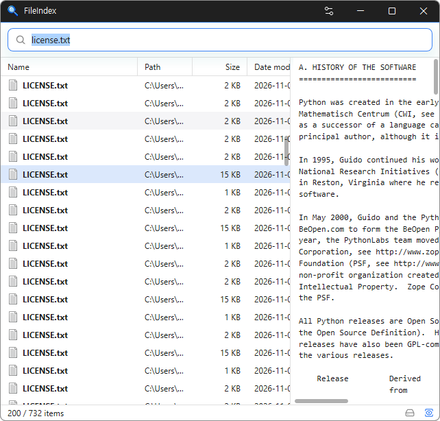

# FileIndex

**ファイル名を入力したそばから PC 全体のファイルを見つけ出す、Windows 用の無料ファイル検索ソフト。**

[English](README.md) · [한국어](README.ko.md) · [简体中文](README.zh-CN.md) · 日本語 · [Español](README.es.md) · [Português (Brasil)](README.pt-BR.md) · [Français](README.fr.md)

> この文書は翻訳版です。内容に相違がある場合は[韓国語版](README.ko.md)が正となります。

-0078D4)

[](https://down.kilho.net/fileindex?lang=ja)



## 概要

FileIndex は、ファイル名で PC のすべてのドライブを一度に検索するソフトです。検索ボックスに文字を入力している間も結果がその都度切り替わり、韓国語の名前は初声(子音)だけでも見つかります(`ㅅㅈ` → 설정)。

初回起動時にドライブのファイル一覧を作っておき、その後はファイルの作成・削除・名前の変更をリアルタイムで追いかけて、常に最新の結果を表示します。拡張子・サイズ・ワイルドカード・正規表現の条件を組み合わせて使え、文書の中の文字で絞り込んだり、名前・サイズ・内容が同じ重複ファイルを見つけたりもできます。

見つけたファイルはエクスプローラーと同じように開く、コピーする、ドラッグ&ドロップする、一覧の中で直接名前を変更する、といった操作ができ、開かずに横で内容をプレビューできます。ウィンドウを閉じてもタスクトレイに残り、トレイアイコンや自分で決めたショートカットキーでいつでもすぐに呼び出せ、隠している間はメモリをほとんど使いません。

## 主な機能

- **入力したそばから検索** — スペースで区切った語をすべて含む名前を探します。大文字・小文字は区別しません。
- **韓国語の初声検索** — `ㅅㅈ` と打つだけで "설정"、"사진" のように初声が一致する名前を見つけます。
- **検索条件** — 拡張子(`ext:`)、サイズ(`size:`)、ワイルドカード(`*` `?`)、正規表現(`regex:`)。
- **内容検索** — 検索語の末尾に `:` と語を付けると(`報告書:予算`)、名前で見つけたテキストファイル・文書のうち、その語を含むものだけを残します。
- **重複ファイルの検出** — 名前が同じもの(`dupe:name`)、サイズが同じもの(`dupe:size`)、内容まで同じもの(`dupe:content`)。
- **リアルタイム反映** — ファイルが変わるとすぐに検索結果へ反映されます。終了していた間の変更も起動時に追いつきます。ごみ箱の中の項目は結果から外します。
- **USB ドライブを自動でインデックス化** — 新しく挿したドライブは自動でインデックスを作成し、取り外すと結果から外します。ドライブ一覧で検索するドライブだけを選ぶこともできます。
- **エクスプローラーと同じ操作** — ダブルクリックで開く、場所を開く、複数選択してコピー、エクスプローラーへドラッグ、一覧の中で直接名前の変更(`F2`)、右クリックメニュー。
- **プレビュー** — 選んだファイルを一覧の横で見られます。写真・動画のサムネイル、PDF の全ページ、ハングル(Hangul)・Word・Excel・PowerPoint 文書の内容、テキストファイルまで。
- **並べ替えと強調表示** — 名前・パス・サイズ・更新日時で並べ替え、名前のうち検索語に一致した部分を強調表示します。
- **タスクトレイに常駐** — ウィンドウを閉じるとトレイに隠れ、トレイアイコンや自分で決めたショートカットキーですぐに呼び出せます。隠している間はメモリをほとんど使いません。
- **22 言語、ライト・ダークテーマ** — 既定では Windows の設定に従い、自分で選ぶこともできます。

## ダウンロード / インストール

| 種類 | リンク |
|---|---|
| インストーラー版 | [ダウンロード](https://down.kilho.net/fileindex?lang=ja) |
| ポータブル版 (ZIP) | [ダウンロード](https://down.kilho.net/fileindex?lang=ja&nosetup) |

インストーラー版はインストールが終わると FileIndex をすぐに起動し、**スタートアップ時に実行** をオンにして、Windows にサインインするたびにタスクトレイで自動的に起動します。ポータブル版は ZIP を展開して `FileIndex.exe` を実行するだけです。どちらも機能は同じです。

ドライブ全体をすばやく読み込むには管理者権限が必要なため、起動時に Windows が管理者権限の確認ウィンドウを表示します。**はい** を押してください。インストーラー版が **スタートアップ時に実行** で起動するときは、確認ウィンドウは表示されません。

## 使い方

### はじめて使う

1. FileIndex を起動します。初回は、ドライブごとにファイル一覧を作る間、画面中央に **C: インデックス作成中 42%** のような進捗が表示されます。終わると検索画面に切り替わります。
2. 検索ボックスにファイル名の一部を入力します。打つそばから下の一覧に結果が表示され、下部に見つかった件数が出ます。
3. 目的のファイルを **ダブルクリック** するか、矢印キーで選んで **Enter** を押すと、関連付けられたプログラムで開きます。ファイルのあるフォルダーを開くには **Ctrl+Enter** を押します。
4. 使い終わったら、ウィンドウの閉じるボタン(X)か **Esc** を押します。プログラムは終了せず、タスクトレイに隠れます。トレイアイコンをクリックするとすぐに再表示されます。

2 回目以降の起動では作成済みの一覧を引き継ぎ、終了していた間の変更だけを追いかけるので、すぐに検索できます。

### 画面構成

| 要素 | 役割 |
|---|---|
| 検索ボックス | ファイル名・初声・検索条件を入力。右側の矢印ボタンは今の検索語で検索し直す |
| 結果一覧 | **名前** · **パス** · **サイズ** · **更新日時**。列見出しをクリックで並べ替え、境界のドラッグで列幅を調整 |
| プレビュー | 一覧の右。選んだファイルのサムネイルや内容。左の境界をドラッグして幅を調整 |
| ステータスバー | 見つかった件数。最大結果数を超えると `200 / 14,092 個の項目` のように表示数 / 総数。右端にドライブ一覧ボタンとプレビューボタン |
| ドライブ一覧 | ステータスバーのドライブボタンで結果の下に開きます。ドライブごとに **合計サイズ** · **空き領域**。行をクリックするとそのドライブを検索するかどうかをオン・オフ、上の境界をドラッグして高さを調整 |
| 設定ボタン | タイトルバーの最小化ボタンの左。**設定** ウィンドウを開きます |
| トレイアイコン | 左クリックでウィンドウを開く。右クリックメニューは **FileIndex** · **作成者** · **終了** |

### こんなときは

**韓国語の名前を初声ですばやく探す**
韓国語の子音だけを入力すると、初声が順に一致する名前を探します。`ㄱㅇㅅ` は "계약서"、"계약서_수정본" のように初声に ㄱ・ㅇ・ㅅ がこの順で含まれる名前を見つけます。長い名前も数文字で探せます。

**複数の語で絞り込む**
スペースで区切って入力すると、すべての語を含む名前だけが残ります。`報告書 2026` は "報告書" と "2026" の両方を含むファイルです。語の順序は関係ありません。

**特定の拡張子だけを探す**
`ext:` の後に拡張子を **セミコロン(;)** でつないで書きます。フォルダーは除かれ、ファイルだけが表示されます。
- `ext:pdf` — PDF ファイルすべて
- `ext:jpg;png;gif 旅行` — 名前に "旅行" を含む画像

**大きなファイルを探してディスク容量を空ける**
`size:` でサイズの条件を付けます。単位は `b` `kb` `mb` `gb` `tb` で、省略するとバイトです。
- `size:>1gb` — 1 GB より大きいファイル
- `size:1mb-5mb` — 1 MB 以上 5 MB 以下(`1mb..5mb` も同じ)
- `ext:mp4 size:>500mb` — 500 MB を超える動画

結果を **サイズ** の列見出しで並べ替えると、大きいファイルから順に見られます。

**ワイルドカードで名前の形を指定する**
`*` は任意の複数文字、`?` は任意の 1 文字です。ワイルドカードを使うと **名前全体** がその形に一致する必要があります。
- `*.txt` — 拡張子が txt のファイル
- `readme*` — readme で始まる名前
- `IMG_????.jpg` — IMG_ の後に 4 文字が続く画像

**正規表現でさらに細かく探す**
`regex:` の後に正規表現を書きます。大文字・小文字は区別せず、名前のどこかに一致すれば対象になります。先頭と末尾を固定するには `^` `$` を使い、スペースは検索語の区切りになるので、パターン内のスペースは `\s` と書きます。
- `regex:^\d{8}` — 8 桁の数字(日付など)で始まる名前
- `regex:(draft|final)` — draft または final を含む名前

条件の書き方を間違えると、ステータスバーに正しい書き方の例が表示されます。

**文書の中の文字で探す**
名前で探す検索語の末尾に `:` と探す文字を付けます。名前で見つけた結果のうち、テキストファイルとハングル(Hangul)・Word・Excel・PowerPoint 文書(hwp・hwpx・doc・docx・xls・xlsx・ppt・pptx)を開いて、その文字を含むものだけを残します。`:` の前はスペースを空けても空けなくてもかまいません。大文字・小文字は区別せず、`:` の後ろはスペースも含めて一つのまとまりとして探します。
- `報告書:予算` — 名前に "報告書" を含む文書のうち "予算" と書かれたもの
- `ext:docx 契約 :違約金` — 名前に "契約" を含む Word 文書のうち "違約金" と書かれたもの
- `議事録 :次回の日程` — "次回の日程" という文字を含む議事録

探している間は、ステータスバーに **内容を検索中 — n/N ファイル** と進捗が表示されます。

**重複ファイルを整理する**
`dupe:` を使うと、同じもの同士をグループにまとめて順に表示します。ほかの条件と一緒に使うと、その結果の中だけで比較します。
- `dupe:name` — 名前が同じファイル(大文字・小文字は区別しない)
- `dupe:size ext:jpg` — サイズが同じ画像
- `dupe:content ext:mp4` — **内容まで完全に同じ** 動画

`dupe:content` は実際にファイルを読んで比較するため、ステータスバーに **内容を比較中 — ファイル n/N、x/y MB** と進捗が表示されます。途中で検索語を変えると比較を止めます。見つかったグループごとに、残したいもの以外を選んで右クリック → 削除すれば完了です。

**ダウンロードしたばかりのファイルを探す**
既定の並べ替えが **更新日時** の新しい順なので、名前の一部を打つだけで、最近ダウンロードしたりファイルを編集したものが一番上に来ます。新しく作成・保存したファイルはすぐに結果に反映されます。

**結果が多すぎるとき / すべて見たいとき**
一覧には既定で **200 件** まで表示されます。検索は常に全体が対象で、並べ替えたうえで先頭から表示するので、"最新の 200 件"、"最も大きい 200 件" になります。ステータスバーの `200 / 14,092 個の項目` は、全 14,092 件のうち 200 件を表示しているという意味です。もっと見るには **設定 → 最大結果数** を増やしてください。

**複数のファイルを別の場所にコピー・移動する**
- **Ctrl・Shift クリック**、**Shift+矢印キー** で複数を選び、**Ctrl+A** で結果をすべて選択します。
- パス・サイズ・日時の列や空いている所を押してドラッグすると、四角形にかかった行がまとめて選ばれます。**Ctrl**・**Shift** を押しながらドラッグすると、今の選択に追加されます。
- **Ctrl+C** でコピーし、エクスプローラーで貼り付けます。
- 選んだファイルの名前の列をドラッグして **エクスプローラーやデスクトップへドラッグ&ドロップ** することもできます。エクスプローラーと同じく、同じドライブなら移動、別のドライブならコピーになります。

**一覧の中で直接名前を変更する**
ファイルを選んで **F2** を押すか、右クリック → **名前の変更** を押します。拡張子の手前までが選ばれた状態で始まるので、そのまま新しい名前を入力します。**Enter** で確定、**Esc** で取り消します。同じ名前がすでにあるときは上書きしません。

**右クリックメニューを使う**
結果を右クリックすると **開く** · **フォルダーを開く** · **切り取り** · **コピー** · **削除** · **名前の変更** · **プロパティ** が表示されます。

エクスプローラーと同じメニュー(プログラムから開く、送る、圧縮など)を使うには、**設定 → 右クリックでエクスプローラーのメニューを使う** をオンにします。このときは開くの下に **パスを開く** · **フルパスをクリップボードにコピー** が加わり、**Shift** を押しながら右クリックすると拡張コマンドも表示されます。このメニューから起動したプログラムは、管理者ではなく通常の権限で動きます。

**写真や文書を開かずに確認する**
**プレビュー** がオンなら(既定)、ファイルを選ぶたびに一覧の右に内容が表示されます。矢印キーで下へ移りながら次々に見られます。
- 写真・動画 — サムネイル
- PDF — 全ページをスクロールして見られます
- ハングル(Hangul)・Word・Excel・PowerPoint — 見出し・段落・表・画像など文書の内容。文字を選んでコピーできます
- テキストファイル — 文字をそのまま。ドラッグで選んで **Ctrl+C** でコピーします

プレビュー領域は境界をドラッグして広げたり狭めたりでき、ステータスバー右端のボタンでオン・オフします。

**USB メモリや外付けディスクから探す**
挿すと数秒で自動的にインデックスを作成し、結果に一緒に表示されます。取り外すとそのドライブの結果は消え、挿し直すと新たにインデックスを作成します。

**特定のドライブだけで探す**
ステータスバー右のドライブボタンで **ドライブ一覧** を開き、検索しないドライブの行をクリックしてオフにします。もう一度クリックするとオンになります。一覧を常に表示するには **設定 → ドライブ一覧** をオンにします。

**キーボードだけで使う**
フォーカスは常に検索ボックスにあるので、すぐに入力できます。

| キー | 動作 |
|---|---|
| ↑ ↓ / PgUp PgDn | 結果を選ぶ(Shift と一緒に押すと範囲選択) |
| Enter | 関連付けられたプログラムで開く(未選択なら最初の結果) |
| Ctrl+Enter | エクスプローラーでファイルの場所を開く |
| Ctrl+A / Ctrl+C | 結果をすべて選択 / 選んだファイルをコピー |
| F2 | 名前の変更 |
| Esc | 検索語を消す。空ならタスクトレイに隠れる |

**ショートカットやスクリプトから検索語を指定して開く**
`--search`(または `-s`)の後に検索語を渡すと、その検索語で検索した画面が開きます。FileIndex がすでに起動していれば、開いているウィンドウがその検索語で検索します。

```
FileIndex.exe --search "ext:pdf 契約書"
FileIndex.exe -s "*.psd"
```

デスクトップのショートカットのリンク先に付けておけば、よく使う検索をワンクリックで開けます。

**常駐させてショートカットキーで呼び出す**
**スタートアップ時に実行** をオンにしておくと、サインイン時にウィンドウを出さずにタスクトレイで起動します。**設定 → ショートカットキー** の欄を押して使いたいキーの組み合わせを押すと(最初はなし)、どのプログラムを使っていてもそのキーで FileIndex を呼び出せます。ほかのプログラムがすでに使っているキーなら知らせてくれます。トレイアイコンを押してもかまいません。どちらでも検索ボックスにカーソルがある状態で表示されるので、そのまま入力できます。プログラムを完全に終了するには、トレイアイコンを右クリック → **終了** を押します。

## 設定

タイトルバーの設定ボタンで **設定** を開きます。変更はすぐに保存され、すぐに反映されます。

| 分類 | 項目 | 既定値 |
|---|---|---|
| 全般 | 既定の並べ替え(名前順 · パス順 · サイズ順 · 更新日時順) | 更新日時順 |
| 全般 | テーマ(システム · ライト · ダーク) | システム |
| 全般 | 言語(システム + 22 言語) | システム |
| 全般 | 最大結果数 | 200 |
| 全般 | ショートカットキー(ウィンドウを呼び出すキーの組み合わせ) | なし |
| 全般 | ドライブ一覧 | オフ |
| 全般 | プレビュー | オン |
| 全般 | 右クリックでエクスプローラーのメニューを使う | オフ |
| 全般 | スタートアップ時に実行 | インストーラー版はオン |
| バージョン情報 | バージョン · 作成者 · ホームページ · ライセンス | — |

**[リセット]** を押すと設定を既定値に戻し、スタートアップ時に実行もオフにします。作成済みのファイル一覧はそのまま残ります。言語を変えると、プログラムを再起動しなくても画面がすぐにその言語に切り替わります。

## 動作環境

- Windows 10 · Windows 11(64 ビット)
- NTFS でフォーマットされたドライブ(Windows の標準形式 — 内蔵ディスクと USB ドライブのどちらも)
- 管理者権限(起動時の確認ウィンドウで **はい**)
- 検索はインターネットに接続していなくてもできます。

## アップデート

FileIndex は自動では更新 **しません**。起動時に新しいバージョンがあるか確認して案内ウィンドウを表示し、**[はい]** を押すとダウンロードページを開いてプログラムを閉じます。新しいバージョンは内部検証の後に手動で配布され、[FileIndex のページ](https://kilho.net/fileindex)で告知されます。[アップデートポリシーのお知らせ](https://en.kilho.net/archives/notice/2940)を参照してください。

## ライセンス

FileIndex は **フリーウェア** です。会社、家庭、官公庁、学校などどこでも制約なく無料で使え、自由に再配布できます。

## リンク

- ウェブサイト: <https://kilho.net/fileindex>
- フォーラム: <https://kilho.top/forum/qna>
- X (Twitter): <https://www.twitter.com/kilhonet>

© KILHO.NET
