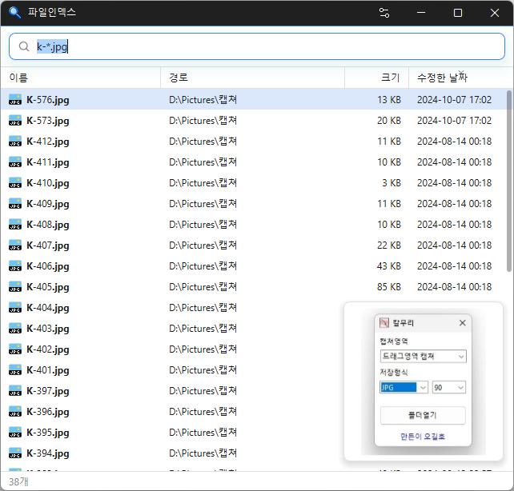

# 파일인덱스

**PC 전체의 파일을 이름으로 입력하는 즉시 찾아 주는 Windows 용 무료 파일 검색 프로그램.**

[English](README.md) · 한국어 · [简体中文](README.zh-CN.md) · [日本語](README.ja.md) · [Español](README.es.md) · [Português (Brasil)](README.pt-BR.md) · [Français](README.fr.md)

-0078D4)

[](https://down.kilho.net/fileindex?lang=ko)



## 개요

파일인덱스는 파일 이름으로 PC 의 모든 드라이브를 한 번에 찾는 검색 프로그램입니다. 검색창에 글자를 치는 동안 결과가 바로바로 바뀌고, 한글 초성만 입력해도 찾습니다(`ㅅㅈ` → 설정).

처음 실행할 때 드라이브의 파일 목록을 만들어 두고, 그 뒤로는 파일이 생기거나 지워지거나 이름이 바뀌는 것을 실시간으로 따라가 늘 최신 결과를 보여 줍니다. 확장자·크기·와일드카드·정규식 조건을 섞어 쓸 수 있고, 이름·크기·내용이 같은 중복 파일도 찾습니다.

찾은 파일은 탐색기처럼 열고, 복사하고, 끌어다 놓고, 우클릭 메뉴를 쓸 수 있습니다. 창을 닫으면 트레이에 머물러 언제든 바로 다시 부를 수 있으며, 숨겨 둔 동안에는 메모리를 거의 쓰지 않습니다.

## 주요 기능

- **입력하는 대로 찾기** — 공백으로 나눈 낱말을 모두 포함한 이름을 찾습니다. 대소문자는 가리지 않습니다.
- **한글 초성 검색** — `ㅅㅈ` 만 쳐도 "설정", "사진" 처럼 초성이 맞는 이름을 찾습니다.
- **검색 조건** — 확장자(`ext:`), 크기(`size:`), 와일드카드(`*` `?`), 정규식(`regex:`).
- **중복 파일 찾기** — 이름이 같은 것(`dupe:name`), 크기가 같은 것(`dupe:size`), 내용까지 같은 것(`dupe:content`).
- **실시간 반영** — 파일이 바뀌면 곧바로 검색 결과에 반영됩니다. 꺼져 있던 동안 바뀐 것도 켤 때 따라잡습니다.
- **USB 드라이브 자동 색인** — 새로 꽂은 드라이브는 알아서 색인하고, 뽑으면 결과에서 뺍니다.
- **탐색기처럼 다루기** — 더블클릭으로 열기, 위치 열기, 여러 개 골라 복사, 탐색기로 끌어다 놓기, 탐색기 우클릭 메뉴.
- **미리보기** — 고른 파일의 썸네일(사진·동영상·PDF·오피스 문서 등)을 목록 옆에 보여 줍니다.
- **정렬과 강조** — 이름·경로·크기·수정한 날짜로 정렬하고, 이름에서 검색어에 맞은 부분을 강조합니다.
- **트레이 상주** — 창을 닫으면 트레이로 숨고, 숨겨 둔 동안에는 메모리를 거의 쓰지 않습니다.
- **PC 안에서만** — 파일 목록은 내 PC 에만 저장됩니다.
- **22개 언어, 라이트·다크 테마** — 기본은 Windows 설정을 따르고 직접 고를 수도 있습니다.

## 다운로드 / 설치

| 종류 | 링크 |
|---|---|
| 설치판 | [다운로드](https://down.kilho.net/fileindex?lang=ko) |
| 무설치판 (ZIP) | [다운로드](https://down.kilho.net/fileindex?lang=ko&nosetup) |

설치판은 설치가 끝나면 파일인덱스를 바로 실행하고, **부팅시 실행** 을 켜 두어 Windows 에 로그인할 때마다 트레이에서 자동으로 시작합니다. 무설치판은 ZIP 을 풀고 `FileIndex.exe` 를 실행하면 됩니다. 두 판의 기능은 같습니다.

드라이브 전체를 빠르게 읽으려면 관리자 권한이 필요하므로, 실행할 때 Windows 가 관리자 권한 확인 창을 띄웁니다. **예** 를 누르면 됩니다.

## 사용법

### 처음 사용하기

1. 파일인덱스를 실행합니다. 처음에는 드라이브마다 파일 목록을 만드는 동안 화면 가운데에 **C: 색인하는 중 42%** 처럼 진행률이 나옵니다. 끝나면 검색 화면으로 바뀝니다.
2. 검색창에 파일 이름의 일부를 입력합니다. 치는 대로 아래 목록에 결과가 나오고, 아래쪽에 찾은 개수가 표시됩니다.
3. 원하는 파일을 **더블클릭** 하거나 방향키로 골라 **Enter** 를 누르면 연결된 프로그램으로 열립니다. 파일이 있는 폴더를 열려면 **Ctrl+Enter** 를 누릅니다.
4. 다 쓰면 창의 닫기(X)나 **Esc** 를 누릅니다. 프로그램은 끝나지 않고 트레이로 숨습니다. 트레이 아이콘을 클릭하면 바로 다시 나타납니다.

두 번째 실행부터는 만들어 둔 목록을 이어받아 꺼져 있던 동안 바뀐 것만 따라잡으므로 곧바로 검색할 수 있습니다.

### 화면 구성

| 요소 | 하는 일 |
|---|---|
| 검색창 | 파일 이름·초성·검색 조건 입력. 오른쪽 화살표 단추는 지금 검색어로 다시 찾기 |
| 결과 목록 | **이름** · **경로** · **크기** · **수정한 날짜**. 열 제목을 누르면 정렬, 경계를 끌면 열 너비 조절 |
| 미리보기 | 목록 오른쪽 아래. 고른 파일의 썸네일 (썸네일이 없는 파일은 숨음) |
| 상태 줄 | 찾은 개수. 최대 결과수보다 많으면 `200 / 14,092개` 처럼 보이는 수 / 전체 수 |
| 설정 단추 | 제목 표시줄의 최소화 단추 왼쪽. **환경설정** 창을 엽니다 |
| 트레이 아이콘 | 왼쪽 클릭으로 창 열기. 우클릭 메뉴는 **파일인덱스** · **만든이** · **종료하기** |

### 이럴 때 이렇게

**한글 이름을 초성으로 빠르게 찾기**
한글 자음만 입력하면 초성이 차례로 맞는 이름을 찾습니다. `ㄱㅇㅅ` 는 "계약서", "계약서_수정본" 처럼 초성이 ㄱ·ㅇ·ㅅ 순서로 들어 있는 이름을 찾습니다. 긴 이름도 몇 글자로 찾을 수 있습니다.

**낱말 여러 개로 좁히기**
공백으로 나눠 입력하면 모든 낱말이 들어 있는 이름만 남습니다. `보고서 2026` 은 "보고서" 와 "2026" 이 모두 들어간 파일입니다. 낱말의 순서는 상관없습니다.

**특정 확장자만 찾기**
`ext:` 뒤에 확장자를 **세미콜론(;)** 으로 이어 씁니다. 폴더는 빠지고 파일만 나옵니다.
- `ext:pdf` — PDF 파일 전부
- `ext:jpg;png;gif 여행` — 이름에 "여행" 이 들어간 사진

**큰 파일 찾아 디스크 공간 확보하기**
`size:` 로 크기 조건을 겁니다. 단위는 `b` `kb` `mb` `gb` `tb` 이고, 없으면 바이트입니다.
- `size:>1gb` — 1 GB 보다 큰 파일
- `size:1mb-5mb` — 1 MB 이상 5 MB 이하 (`1mb..5mb` 도 같음)
- `ext:mp4 size:>500mb` — 500 MB 넘는 동영상

결과를 **크기** 열 제목으로 정렬하면 가장 큰 파일부터 볼 수 있습니다.

**와일드카드로 이름 모양 맞추기**
`*` 는 아무 글자 여러 개, `?` 는 아무 글자 하나입니다. 와일드카드를 쓰면 **이름 전체**가 그 모양이어야 합니다.
- `*.txt` — 확장자가 txt 인 파일
- `readme*` — readme 로 시작하는 이름
- `IMG_????.jpg` — IMG_ 뒤에 네 글자가 오는 사진

**정규식으로 더 정밀하게 찾기**
`regex:` 뒤에 정규식을 씁니다. 대소문자는 가리지 않고, 이름 어디든 맞으면 됩니다. 처음과 끝을 고정하려면 `^` `$` 를 쓰고, 공백은 검색어를 나누므로 패턴 안의 공백은 `\s` 로 씁니다.
- `regex:^\d{8}` — 숫자 8자리(날짜 등)로 시작하는 이름
- `regex:(draft|초안)` — draft 나 초안이 들어간 이름

조건을 잘못 쓰면 상태 줄에 바르게 쓰는 예를 보여 줍니다.

**중복 파일 정리하기**
`dupe:` 를 쓰면 같은 것끼리 묶어서 차례로 보여 줍니다. 다른 조건과 함께 쓰면 그 결과 안에서만 비교합니다.
- `dupe:name` — 이름이 같은 파일 (대소문자 무시)
- `dupe:size ext:jpg` — 크기가 같은 사진
- `dupe:content ext:mp4` — **내용까지 똑같은** 동영상

`dupe:content` 는 실제로 파일을 읽어 비교하므로 상태 줄에 **내용 비교 중 — 파일 n/N, x/y MB** 로 진행이 표시됩니다. 도중에 검색어를 바꾸면 비교를 멈춥니다. 찾은 묶음에서 남길 것만 빼고 골라 우클릭 → 삭제하면 됩니다.

**방금 받은 파일 찾기**
기본 정렬이 **수정한 날짜** 최신순이라, 이름 일부만 쳐도 가장 최근에 받거나 고친 파일이 맨 위에 옵니다. 파일을 새로 만들거나 저장하면 바로 결과에 반영됩니다.

**결과가 너무 많을 때 / 전부 보고 싶을 때**
목록에는 기본으로 **200개** 까지 보입니다. 검색은 언제나 전체를 대상으로 하고, 정렬한 뒤 앞에서부터 보여 주므로 "가장 최근 200개", "가장 큰 200개" 가 됩니다. 상태 줄의 `200 / 14,092개` 는 전체 14,092개 중 200개가 보인다는 뜻입니다. 더 보려면 **환경설정 → 최대 결과수** 를 늘리세요.

**여러 파일을 다른 곳으로 복사·이동하기**
- **Ctrl·Shift 클릭**, **Shift+방향키**로 여러 개를 고르고, **Ctrl+A** 로 결과 전체를 고릅니다.
- **Ctrl+C** 로 복사한 뒤 탐색기에서 붙여 넣습니다.
- 고른 파일을 **탐색기나 바탕 화면으로 끌어다 놓을** 수도 있습니다. 탐색기와 똑같이 같은 드라이브면 이동, 다른 드라이브면 복사됩니다.

**탐색기 우클릭 메뉴 쓰기**
결과를 우클릭하면 탐색기와 같은 메뉴(연결 프로그램, 보내기, 압축, 삭제, 속성 등)가 나옵니다. **Shift** 를 누른 채 우클릭하면 확장 명령까지 나옵니다. 메뉴에서 실행한 프로그램은 관리자가 아닌 일반 권한으로 뜹니다.

**사진·문서를 열지 않고 확인하기**
**미리보기** 가 켜져 있으면(기본) 파일을 고를 때마다 목록 오른쪽 아래에 썸네일이 나옵니다. 탐색기 썸네일과 같아 사진뿐 아니라 동영상·PDF·오피스 문서도 보입니다. 방향키로 내려가며 차례로 훑어볼 수 있습니다.

**USB 메모리나 외장 디스크에서 찾기**
꽂으면 몇 초 안에 알아서 색인하고 결과에 함께 나옵니다. 뽑으면 그 드라이브의 결과는 빠지고, 다시 꽂으면 새로 색인합니다.

**키보드만으로 쓰기**
포커스는 언제나 검색창에 있어 바로 칠 수 있습니다.

| 키 | 동작 |
|---|---|
| ↑ ↓ / PgUp PgDn | 결과 고르기 (Shift 를 함께 누르면 범위 선택) |
| Enter | 연결된 프로그램으로 열기 (고른 것이 없으면 첫 결과) |
| Ctrl+Enter | 탐색기에서 파일 위치 열기 |
| Ctrl+A / Ctrl+C | 결과 전체 선택 / 고른 파일 복사 |
| Esc | 검색어 지우기, 비어 있으면 트레이로 숨기 |

**바로 가기나 스크립트에서 검색어로 바로 열기**
`--search`(또는 `-s`) 뒤에 검색어를 주면 그 검색어로 찾은 화면이 뜹니다. 파일인덱스가 이미 떠 있으면 떠 있는 창이 그 검색어로 찾습니다.

```
FileIndex.exe --search "ext:pdf 계약서"
FileIndex.exe -s "*.psd"
```

바탕 화면 바로 가기의 대상에 붙여 두면 자주 찾는 검색을 한 번에 열 수 있습니다.

**늘 켜 두고 단축키처럼 쓰기**
**부팅시 실행** 을 켜 두면 로그인할 때 창 없이 트레이에서 시작합니다. 필요할 때 트레이 아이콘을 누르면 검색창에 커서가 놓인 채 나타나므로 바로 입력하면 됩니다. 프로그램을 완전히 끄려면 트레이 우클릭 → **종료하기** 를 누릅니다.

## 설정

제목 표시줄의 설정 단추로 **환경설정** 을 엽니다. 바꾸는 즉시 저장되고 바로 적용됩니다.

| 분류 | 항목 | 기본값 |
|---|---|---|
| 일반 | 기본 정렬 (이름순 · 경로순 · 크기순 · 수정일순) | 수정일순 |
| 일반 | 테마 (시스템 · 라이트 · 다크) | 시스템 |
| 일반 | 언어 (시스템 + 22개 언어) | 시스템 |
| 일반 | 최대 결과수 | 200 |
| 일반 | 미리보기 | 켜짐 |
| 일반 | 부팅시 실행 | 설치판은 켜짐 |
| 정보 | 버전 · 만든이 · 홈페이지 · 라이선스 | — |

**[초기화]** 를 누르면 환경설정을 처음 값으로 되돌리고 부팅시 실행도 끕니다. 만들어 둔 파일 목록은 그대로 둡니다. 언어를 바꾸면 프로그램을 다시 시작하지 않아도 화면이 바로 그 언어로 바뀝니다.

## 요구 사항

- Windows 10 · Windows 11 (64비트)
- NTFS 로 포맷된 드라이브 (Windows 기본 형식 — 내장 디스크와 USB 드라이브 모두)
- 관리자 권한 (실행할 때 확인 창에서 **예**)
- 인터넷은 새 버전 안내를 확인할 때만 사용합니다. 검색은 오프라인에서도 됩니다.

## 업데이트

파일인덱스는 자동으로 업데이트하지 **않습니다**. 실행할 때 새 버전이 있는지 확인해 안내 창을 띄우고, **[예]** 를 누르면 다운로드 페이지를 열고 프로그램을 닫습니다. 새 버전은 내부 검증 후 수동으로 배포되고 [파일인덱스 페이지](https://kilho.net/fileindex)에 공지됩니다. [업데이트 정책 안내](https://kilho.net/archives/notice/2940)를 참고하세요.

## 라이선스

파일인덱스는 **프리웨어**입니다. 회사, 집, 관공서, 학교 등 어디서나 제약 없이 무료로 쓸 수 있고, 자유롭게 재배포할 수 있습니다.

## 링크

- 웹사이트: <https://kilho.net/fileindex>
- 포럼: <https://kilho.top/forum/qna>
- X (Twitter): <https://www.twitter.com/kilhonet>

© KILHO.NET
