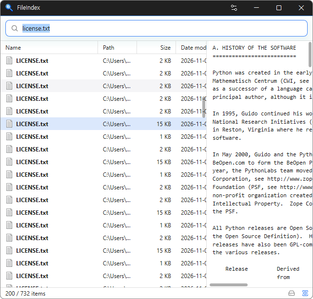

# FileIndex

**A free file search tool for Windows that finds files across your whole PC the moment you type a name.**

English · [한국어](README.ko.md) · [简体中文](README.zh-CN.md) · [日本語](README.ja.md) · [Español](README.es.md) · [Português (Brasil)](README.pt-BR.md) · [Français](README.fr.md)

> This document is a translation. If anything differs, the [Korean version](README.ko.md) is authoritative.

-0078D4)

[](https://down.kilho.net/fileindex?lang=en)



## Overview

FileIndex searches every drive on your PC by file name at once. Results update as you type, and Korean users can search with initial consonants alone (`ㅅㅈ` → 설정).

On first run it builds a list of the files on each drive. From then on it follows files being created, deleted and renamed in real time, so results are always current. You can combine extension, size, wildcard and regular-expression conditions, narrow results down by the text inside documents, or find duplicate files with the same name, size or content.

Found files can be opened, copied, dragged and renamed right in the list just like in File Explorer, and previewed next to the list without opening them. Closing the window keeps FileIndex in the tray, ready to come back instantly from the tray icon or a shortcut key of your choice, and while hidden it uses almost no memory.

## Features

- **Search as you type** — finds names containing every space-separated word. Case-insensitive.
- **Korean initial-consonant search** — typing just `ㅅㅈ` finds names such as "설정" and "사진".
- **Search conditions** — extension (`ext:`), size (`size:`), wildcards (`*` `?`), regular expressions (`regex:`).
- **Content search** — add `:` and a word to the end of your search (`report:budget`) to keep only the text files and documents found by name that contain that word.
- **Duplicate finder** — same name (`dupe:name`), same size (`dupe:size`), identical content (`dupe:content`).
- **Real-time updates** — file changes show up in results right away. Changes made while FileIndex was off are caught up at startup. Items in the Recycle Bin are left out of results.
- **Automatic USB indexing** — newly plugged-in drives are indexed on their own and dropped from results when removed. You can also pick which drives to search in the drive list.
- **Works like File Explorer** — double-click to open, open file location, multi-select and copy, drag into Explorer, rename right in the list (`F2`), right-click menu.
- **Preview** — view the selected file next to the list: photo and video thumbnails, every page of a PDF, the contents of Hangul, Word, Excel and PowerPoint documents, and text files.
- **Sorting and highlighting** — sort by name, path, size or date modified; the part of each name that matched is highlighted.
- **Lives in the tray** — closing the window hides it to the tray; bring it back instantly with the tray icon or a shortcut key of your choice. While hidden it uses almost no memory.
- **22 languages, light and dark themes** — follows your Windows settings by default, or choose your own.

## Download / Installation

| Type | Link |
|---|---|
| Installer | [Download](https://down.kilho.net/fileindex?lang=en) |
| Portable (ZIP) | [Download](https://down.kilho.net/fileindex?lang=en&nosetup) |

The installer launches FileIndex when it finishes and turns on **Run at startup**, so it starts in the tray every time you sign in to Windows. For the portable version, unzip it and run `FileIndex.exe`. Both versions have the same features.

Reading whole drives quickly requires administrator rights, so Windows shows an administrator confirmation prompt when FileIndex starts. Click **Yes**. When the installer version starts through **Run at startup**, no prompt appears.

## Usage

### Getting started

1. Run FileIndex. The first time, while it builds the file list for each drive, the center of the window shows progress such as **C: indexing 42%**. When it finishes, the search screen appears.
2. Type part of a file name in the search box. Results appear in the list as you type, and the number found is shown at the bottom.
3. **Double-click** the file you want, or select it with the arrow keys and press **Enter**, to open it in its associated program. Press **Ctrl+Enter** to open the folder that contains it.
4. When you're done, click the window's close button (X) or press **Esc**. FileIndex doesn't quit — it hides in the tray. Click the tray icon to bring it right back.

From the second run on, FileIndex picks up the list it already built and only catches up on what changed while it was off, so you can search immediately.

### Screen layout

| Element | What it does |
|---|---|
| Search box | Enter a file name, initial consonants or search conditions. The arrow button on the right searches again with the current text |
| Result list | **Name** · **Path** · **Size** · **Date modified**. Click a column header to sort; drag a border to resize a column |
| Preview | Right of the list. Thumbnail or contents of the selected file. Drag its left border to resize |
| Status bar | Number of results. If there are more than the max results, it shows shown / total, e.g. `200 / 14,092 items`. The drive list button and the preview button sit at the right end |
| Drive list | Opens below the results with the drive button in the status bar. Shows **Total size** · **Free space** for each drive. Click a row to turn searching that drive on or off; drag the top border to resize |
| Settings button | In the title bar, left of the minimize button. Opens the **Settings** window |
| Tray icon | Left-click to open the window. The right-click menu has **FileIndex** · **Author** · **Exit** |

### Tips and scenarios

**Find Korean names by initial consonants**
Typing only Korean consonants finds names whose initial consonants appear in that order. `ㄱㅇㅅ` finds names such as "계약서" and "계약서_수정본", whose initials contain ㄱ, ㅇ, ㅅ in sequence. Even long names can be found in a few keystrokes.

**Narrow down with several words**
Separate words with spaces and only names containing all of them remain. `report 2026` finds files with both "report" and "2026" in the name. Word order doesn't matter.

**Find only certain file types**
Write extensions after `ext:`, separated by **semicolons (;)**. Folders are excluded; only files appear.
- `ext:pdf` — all PDF files
- `ext:jpg;png;gif travel` — pictures with "travel" in the name

**Find large files to free up disk space**
Use `size:` for a size condition. Units are `b` `kb` `mb` `gb` `tb`; without a unit it means bytes.
- `size:>1gb` — files larger than 1 GB
- `size:1mb-5mb` — from 1 MB to 5 MB inclusive (`1mb..5mb` works too)
- `ext:mp4 size:>500mb` — videos over 500 MB

Sort the results by the **Size** column header to see the largest files first.

**Match a name pattern with wildcards**
`*` matches any number of characters and `?` matches exactly one. With wildcards the **whole name** must match the pattern.
- `*.txt` — files with the txt extension
- `readme*` — names starting with readme
- `IMG_????.jpg` — pictures with four characters after IMG_

**Search more precisely with regular expressions**
Write a regular expression after `regex:`. It is case-insensitive and may match anywhere in the name. Use `^` and `$` to anchor the start and end; since spaces split search terms, write a space inside a pattern as `\s`.
- `regex:^\d{8}` — names starting with eight digits (such as a date)
- `regex:(draft|final)` — names containing draft or final

If a condition is written incorrectly, the status bar shows an example of the correct form.

**Search by the text inside documents**
Add `:` and the text to look for at the end of your name search. Among the results found by name, FileIndex opens text files and Hangul, Word, Excel and PowerPoint documents (hwp, hwpx, doc, docx, xls, xlsx, ppt, pptx) and keeps only those containing that text. The `:` can be written with or without a space before it. It is case-insensitive, and everything after the `:`, spaces included, is searched as one phrase.
- `report:budget` — documents with "report" in the name that contain "budget"
- `ext:docx contract :penalty` — Word documents with "contract" in the name that contain "penalty"
- `minutes :next meeting` — meeting minutes containing the phrase "next meeting"

While it searches, the status bar shows progress as **Searching contents — n/N files**.

**Clean up duplicate files**
`dupe:` groups matching files together and shows them group by group. Combined with other conditions, it compares only within those results.
- `dupe:name` — files with the same name (case-insensitive)
- `dupe:size ext:jpg` — pictures with the same size
- `dupe:content ext:mp4` — videos with **exactly the same content**

`dupe:content` actually reads the files to compare them, so the status bar shows progress as **Comparing contents — files n/N, x/y MB**. Changing the search text stops the comparison. In each group, select everything except the copy you want to keep, then right-click → Delete.

**Find a file you just downloaded**
The default sort is **Date modified**, newest first, so typing just part of a name puts the most recently downloaded or edited file at the top. Newly created or saved files appear in the results right away.

**Too many results / want to see them all**
By default the list shows up to **200** results. The search always covers everything, sorts it, and then shows from the top — so you get "the 200 most recent" or "the 200 largest". `200 / 14,092 items` in the status bar means 200 of 14,092 results are shown. To see more, raise **Settings → Max results**.

**Copy or move several files elsewhere**
- Select several with **Ctrl/Shift-click** or **Shift+arrow keys**, or press **Ctrl+A** to select all results.
- Press and drag on the path, size or date columns or on an empty area to select every row the rectangle touches. Hold **Ctrl** or **Shift** while dragging to add to the current selection.
- Press **Ctrl+C**, then paste in File Explorer.
- You can also drag the name of the selected files **into Explorer or onto the desktop**. Just like Explorer, they are moved on the same drive and copied to a different drive.

**Rename right in the list**
Select a file and press **F2**, or right-click → **Rename**. Editing starts with the name selected up to the extension, so just type the new name. Press **Enter** to confirm or **Esc** to cancel. If a file with that name already exists, it is not overwritten.

**Use the right-click menu**
Right-click a result for **Open** · **Open folder** · **Cut** · **Copy** · **Delete** · **Rename** · **Properties**.

To get the same menu as in Explorer (Open with, Send to, compress and so on), turn on **Settings → Use Explorer menu on right-click**. That menu adds **Open path** · **Copy full path to clipboard** below Open, and holding **Shift** while right-clicking shows extended commands too. Programs started from this menu run with normal user rights, not as administrator.

**Check photos and documents without opening them**
With **Preview** on (the default), the contents of each file you select appear to the right of the list. Step through them with the arrow keys.
- Photos and videos — thumbnail
- PDF — scroll through every page
- Hangul, Word, Excel and PowerPoint — the document's contents, such as headings, paragraphs, tables and pictures. You can select and copy the text
- Text files — the text as is. Drag to select and copy with **Ctrl+C**

Drag the preview area's border to widen or narrow it, and turn it on or off with the button at the right end of the status bar.

**Search USB sticks and external drives**
Plug one in and within a few seconds it is indexed and included in results. When you unplug it, its results disappear; plug it back in and it is indexed afresh.

**Search only certain drives**
Open the **Drive list** with the drive button at the right of the status bar, and click the row of a drive you don't want to search to turn it off. Click again to turn it back on. To keep the list always visible, turn on **Settings → Drive list**.

**Keyboard only**
The focus always stays in the search box, so you can just type.

| Key | Action |
|---|---|
| ↑ ↓ / PgUp PgDn | Select results (hold Shift to select a range) |
| Enter | Open in the associated program (the first result if none is selected) |
| Ctrl+Enter | Open the file location in Explorer |
| Ctrl+A / Ctrl+C | Select all results / copy selected files |
| F2 | Rename |
| Esc | Clear the search text; if already empty, hide to the tray |

**Open a search straight from a shortcut or script**
Give a search after `--search` (or `-s`) and FileIndex opens with those results. If FileIndex is already running, the open window runs that search.

```
FileIndex.exe --search "ext:pdf contract"
FileIndex.exe -s "*.psd"
```

Add it to the target of a desktop shortcut to open a frequent search in one click.

**Keep it running and call it with a shortcut key**
With **Run at startup** on, FileIndex starts in the tray without a window when you sign in. Click the **Settings → Shortcut key** box and press the key combination you want (none at first); then that key brings up FileIndex whatever program you are using. If another program already uses the key, you are told so. Clicking the tray icon works too. Either way it appears with the cursor already in the search box, so just start typing. To quit completely, right-click the tray icon → **Exit**.

## Configuration

Open **Settings** with the settings button in the title bar. Changes are saved and applied immediately.

| Section | Item | Default |
|---|---|---|
| General | Default sort (By name · By path · By size · By date modified) | By date modified |
| General | Theme (System · Light · Dark) | System |
| General | Language (System + 22 languages) | System |
| General | Max results | 200 |
| General | Shortcut key (key combination that brings up the window) | None |
| General | Drive list | Off |
| General | Preview | On |
| General | Use Explorer menu on right-click | Off |
| General | Run at startup | On for the installer version |
| About | Version · Author · Homepage · License | — |

**[Reset]** restores the settings to their defaults and also turns off Run at startup. The file list already built is kept. Changing the language switches the screen to that language right away, without restarting.

## Requirements

- Windows 10 · Windows 11 (64-bit)
- Drives formatted as NTFS (the Windows default — both internal disks and USB drives)
- Administrator rights (click **Yes** at the prompt when starting)
- Searching works without an internet connection.

## Updates

FileIndex does **not** update itself. At startup it checks for a new version and shows a notice; clicking **[Yes]** opens the download page and closes the program. New versions are released manually after internal testing and announced on the [FileIndex page](https://kilho.net/fileindex). See the [update policy notice](https://en.kilho.net/archives/notice/2940).

## License

FileIndex is **freeware**. Use it free of charge anywhere — at the office, at home, in government offices or at school — and redistribute it freely.

## Links

- Website: <https://kilho.net/fileindex>
- Forum: <https://kilho.top/forum/qna>
- X (Twitter): <https://www.twitter.com/kilhonet>

© KILHO.NET
