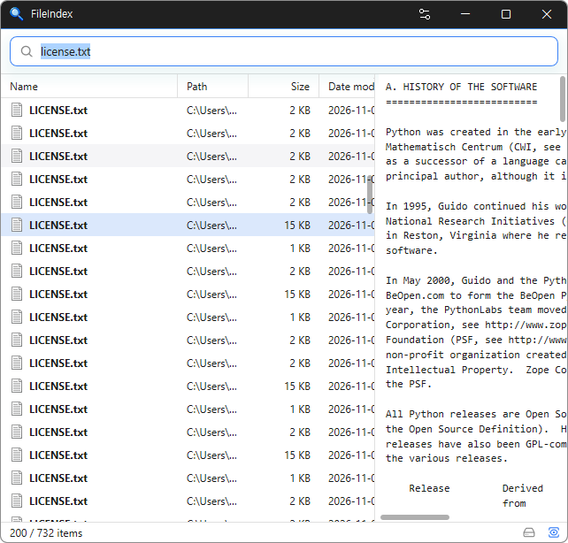

# FileIndex

**Pesquisador de arquivos gratuito para Windows que encontra arquivos em todo o PC assim que você digita um nome.**

[English](README.md) · [한국어](README.ko.md) · [简体中文](README.zh-CN.md) · [日本語](README.ja.md) · [Español](README.es.md) · Português (Brasil) · [Français](README.fr.md)

> Este documento é uma tradução. Em caso de divergência, a [versão em coreano](README.ko.md) prevalece.

-0078D4)

[](https://down.kilho.net/fileindex?lang=pt)



## Visão geral

O FileIndex pesquisa por nome de arquivo em todas as unidades do PC de uma só vez. Os resultados mudam enquanto você digita na caixa de pesquisa, e nomes em coreano podem ser encontrados digitando apenas as consoantes iniciais (`ㅅㅈ` → 설정).

Na primeira execução ele monta uma lista dos arquivos de cada unidade; daí em diante acompanha em tempo real os arquivos criados, excluídos e renomeados, para que os resultados estejam sempre atualizados. Você pode combinar condições de extensão, tamanho, curingas e expressões regulares, refinar os resultados pelo texto dentro dos documentos ou encontrar arquivos duplicados com o mesmo nome, tamanho ou conteúdo.

Os arquivos encontrados podem ser abertos, copiados, arrastados e renomeados direto na lista, como no Explorador de Arquivos, e visualizados ao lado da lista sem abri-los. Ao fechar a janela, o FileIndex fica na bandeja do sistema, pronto para voltar na hora pelo ícone da bandeja ou por uma tecla de atalho que você escolher, e enquanto está oculto quase não usa memória.

## Recursos

- **Pesquisa enquanto você digita** — encontra nomes que contêm todas as palavras separadas por espaço. Não diferencia maiúsculas de minúsculas.
- **Pesquisa por consoantes iniciais coreanas** — basta digitar `ㅅㅈ` para encontrar nomes como "설정" e "사진".
- **Condições de pesquisa** — extensão (`ext:`), tamanho (`size:`), curingas (`*` `?`), expressões regulares (`regex:`).
- **Pesquisa no conteúdo** — acrescente `:` e uma palavra ao fim da pesquisa (`relatorio:orçamento`) para manter só os arquivos de texto e documentos encontrados pelo nome que contêm essa palavra.
- **Localizador de duplicados** — mesmo nome (`dupe:name`), mesmo tamanho (`dupe:size`), conteúdo idêntico (`dupe:content`).
- **Atualização em tempo real** — as mudanças nos arquivos aparecem logo nos resultados. O que mudou enquanto o FileIndex estava fechado é atualizado ao iniciá-lo. Os itens da Lixeira ficam fora dos resultados.
- **Indexação automática de unidades USB** — unidades recém-conectadas são indexadas sozinhas e saem dos resultados quando removidas. Você também pode escolher na lista de unidades em quais pesquisar.
- **Funciona como o Explorador** — clique duplo para abrir, abrir o local, seleção múltipla e cópia, arrastar para o Explorador, renomear direto na lista (`F2`), menu de contexto.
- **Visualização** — veja o arquivo selecionado ao lado da lista: miniaturas de fotos e vídeos, todas as páginas de um PDF, o conteúdo de documentos do Hangul, Word, Excel e PowerPoint, e arquivos de texto.
- **Classificação e destaque** — classifica por nome, caminho, tamanho ou data de modificação; a parte do nome que corresponde é destacada.
- **Fica na bandeja** — ao fechar a janela, ele se esconde na bandeja; volta na hora pelo ícone da bandeja ou por uma tecla de atalho que você escolher. Enquanto está oculto quase não usa memória.
- **22 idiomas, temas claro e escuro** — segue as configurações do Windows por padrão, ou você mesmo escolhe.

## Download / instalação

| Tipo | Link |
|---|---|
| Instalador | [Baixar](https://down.kilho.net/fileindex?lang=pt) |
| Portátil (ZIP) | [Baixar](https://down.kilho.net/fileindex?lang=pt&nosetup) |

O instalador abre o FileIndex ao terminar e ativa **Executar ao iniciar**, para que ele comece na bandeja sempre que você entrar no Windows. Na versão portátil, descompacte o ZIP e execute `FileIndex.exe`. As duas versões têm os mesmos recursos.

Ler unidades inteiras rapidamente exige direitos de administrador, então o Windows mostra uma janela de confirmação de administrador quando o FileIndex inicia. Clique em **Sim**. Quando a versão com instalador inicia por **Executar ao iniciar**, nenhuma confirmação aparece.

## Uso

### Primeiros passos

1. Execute o FileIndex. Na primeira vez, enquanto ele monta a lista de arquivos de cada unidade, o centro da janela mostra o progresso, por exemplo **C: indexando 42%**. Ao terminar, aparece a tela de pesquisa.
2. Digite parte de um nome de arquivo na caixa de pesquisa. Os resultados aparecem na lista enquanto você digita, e embaixo aparece quantos foram encontrados.
3. Dê um **clique duplo** no arquivo desejado, ou selecione-o com as setas e pressione **Enter**, para abri-lo no programa associado. Pressione **Ctrl+Enter** para abrir a pasta que o contém.
4. Quando terminar, clique no botão de fechar (X) ou pressione **Esc**. O FileIndex não é encerrado: ele se esconde na bandeja. Clique no ícone da bandeja para trazê-lo de volta na hora.

A partir da segunda execução, o FileIndex reaproveita a lista já montada e só atualiza o que mudou enquanto estava fechado, então você pode pesquisar imediatamente.

### Elementos da tela

| Elemento | O que faz |
|---|---|
| Caixa de pesquisa | Digite um nome de arquivo, consoantes iniciais ou condições de pesquisa. O botão de seta à direita pesquisa de novo com o texto atual |
| Lista de resultados | **Nome** · **Caminho** · **Tamanho** · **Data de modificação**. Clique no cabeçalho de uma coluna para classificar; arraste uma borda para mudar a largura |
| Visualização | À direita da lista. Miniatura ou conteúdo do arquivo selecionado. Arraste a borda esquerda para mudar a largura |
| Barra de status | Número de resultados. Se houver mais que o máximo de resultados, mostra exibidos / total, p. ex. `200 / 14,092 itens`. Na ponta direita ficam o botão da lista de unidades e o botão da visualização |
| Lista de unidades | Abre abaixo dos resultados pelo botão de unidades na barra de status. Mostra **Tamanho total** · **Espaço livre** de cada unidade. Clique em uma linha para ligar ou desligar a pesquisa nessa unidade; arraste a borda superior para mudar a altura |
| Botão de configurações | Na barra de título, à esquerda do botão de minimizar. Abre a janela **Configurações** |
| Ícone da bandeja | Clique esquerdo para abrir a janela. O menu de contexto tem **FileIndex** · **Autor** · **Sair** |

### Situações de uso

**Encontrar nomes coreanos pelas consoantes iniciais**
Digitando apenas consoantes coreanas, você encontra nomes cujas iniciais aparecem nessa ordem. `ㄱㅇㅅ` encontra nomes como "계약서" e "계약서_수정본", cujas iniciais contêm ㄱ, ㅇ, ㅅ em sequência. Até nomes longos são encontrados com poucas teclas.

**Refinar com várias palavras**
Separe as palavras com espaços e só ficam os nomes que contêm todas elas. `relatorio 2026` encontra arquivos com "relatorio" e "2026" no nome. A ordem das palavras não importa.

**Encontrar só certos tipos de arquivo**
Escreva as extensões depois de `ext:`, separadas por **ponto e vírgula (;)**. As pastas ficam de fora; só aparecem arquivos.
- `ext:pdf` — todos os arquivos PDF
- `ext:jpg;png;gif viagem` — imagens com "viagem" no nome

**Encontrar arquivos grandes para liberar espaço**
Use `size:` para uma condição de tamanho. As unidades são `b` `kb` `mb` `gb` `tb`; sem unidade, são bytes.
- `size:>1gb` — arquivos maiores que 1 GB
- `size:1mb-5mb` — de 1 MB a 5 MB, inclusive (`1mb..5mb` também funciona)
- `ext:mp4 size:>500mb` — vídeos acima de 500 MB

Classifique os resultados pelo cabeçalho **Tamanho** para ver primeiro os maiores arquivos.

**Definir o formato de um nome com curingas**
`*` corresponde a qualquer quantidade de caracteres e `?` a exatamente um. Com curingas, **o nome inteiro** precisa corresponder ao padrão.
- `*.txt` — arquivos com extensão txt
- `readme*` — nomes que começam com readme
- `IMG_????.jpg` — imagens com quatro caracteres depois de IMG_

**Pesquisar com mais precisão usando expressões regulares**
Escreva uma expressão regular depois de `regex:`. Não diferencia maiúsculas de minúsculas e pode corresponder em qualquer parte do nome. Use `^` e `$` para fixar o início e o fim; como os espaços separam os termos de pesquisa, escreva um espaço dentro do padrão como `\s`.
- `regex:^\d{8}` — nomes que começam com oito dígitos (como uma data)
- `regex:(draft|final)` — nomes que contêm draft ou final

Se uma condição estiver escrita errado, a barra de status mostra um exemplo da forma correta.

**Pesquisar pelo texto dentro dos documentos**
Acrescente `:` e o texto procurado ao fim da pesquisa por nome. Entre os resultados encontrados pelo nome, o FileIndex abre os arquivos de texto e os documentos do Hangul, Word, Excel e PowerPoint (hwp, hwpx, doc, docx, xls, xlsx, ppt, pptx) e mantém só os que contêm esse texto. O `:` pode vir com ou sem espaço antes. Não diferencia maiúsculas de minúsculas, e tudo o que vem depois do `:`, espaços incluídos, é pesquisado como uma única frase.
- `relatorio:orçamento` — documentos com "relatorio" no nome que contêm "orçamento"
- `ext:docx contrato :multa` — documentos do Word com "contrato" no nome que contêm "multa"
- `ata :próxima reunião` — atas que contêm a frase "próxima reunião"

Durante a pesquisa, a barra de status mostra o progresso como **Pesquisando conteúdo — n/N arquivos**.

**Limpar arquivos duplicados**
`dupe:` agrupa os arquivos correspondentes e os mostra grupo por grupo. Combinado com outras condições, compara apenas dentro desses resultados.
- `dupe:name` — arquivos com o mesmo nome (sem diferenciar maiúsculas)
- `dupe:size ext:jpg` — imagens do mesmo tamanho
- `dupe:content ext:mp4` — vídeos com **exatamente o mesmo conteúdo**

O `dupe:content` lê os arquivos de verdade para compará-los, então a barra de status mostra o progresso como **Comparando conteúdo — arquivos n/N, x/y MB**. Mudar o texto da pesquisa interrompe a comparação. Em cada grupo, selecione tudo exceto a cópia que quer manter e depois clique direito → Excluir.

**Encontrar um arquivo recém-baixado**
A classificação padrão é **Data de modificação**, do mais recente para o mais antigo, então basta digitar parte de um nome para o arquivo baixado ou editado mais recentemente ficar no topo. Arquivos novos ou recém-salvos aparecem logo nos resultados.

**Resultados demais / quer ver todos**
Por padrão a lista mostra até **200** resultados. A pesquisa sempre abrange tudo, classifica e mostra a partir do topo — então você vê "os 200 mais recentes" ou "os 200 maiores". `200 / 14,092 itens` na barra de status significa que 200 de 14.092 resultados estão sendo exibidos. Para ver mais, aumente **Configurações → Máx. de resultados**.

**Copiar ou mover vários arquivos para outro lugar**
- Selecione vários com **Ctrl/Shift + clique** ou **Shift + setas**, ou pressione **Ctrl+A** para selecionar todos os resultados.
- Pressione e arraste sobre as colunas de caminho, tamanho ou data, ou sobre uma área vazia, para selecionar todas as linhas que o retângulo toca. Segure **Ctrl** ou **Shift** ao arrastar para somar à seleção atual.
- Pressione **Ctrl+C** e cole no Explorador de Arquivos.
- Você também pode arrastar o nome dos arquivos selecionados **para o Explorador ou para a área de trabalho**. Como no Explorador, eles são movidos na mesma unidade e copiados para outra unidade.

**Renomear direto na lista**
Selecione um arquivo e pressione **F2**, ou clique direito → **Renomear**. A edição começa com o nome selecionado até a extensão, então é só digitar o novo nome. Pressione **Enter** para confirmar ou **Esc** para cancelar. Se já existir um arquivo com esse nome, ele não é sobrescrito.

**Usar o menu de contexto**
Clique com o botão direito em um resultado para ver **Abrir** · **Abrir pasta** · **Recortar** · **Copiar** · **Excluir** · **Renomear** · **Propriedades**.

Para ter o mesmo menu do Explorador (Abrir com, Enviar para, compactar etc.), ligue **Configurações → Usar o menu do Explorador ao clicar com o botão direito**. Esse menu acrescenta **Abrir caminho** · **Copiar caminho completo para a área de transferência** abaixo de Abrir, e segurar **Shift** ao clicar com o botão direito mostra também os comandos estendidos. Os programas iniciados por esse menu rodam com direitos normais de usuário, não como administrador.

**Ver fotos e documentos sem abri-los**
Com a **Visualização** ligada (padrão), a cada arquivo selecionado o conteúdo aparece à direita da lista. Percorra-os com as setas.
- Fotos e vídeos — miniatura
- PDF — role por todas as páginas
- Hangul, Word, Excel e PowerPoint — o conteúdo do documento, como títulos, parágrafos, tabelas e imagens. Dá para selecionar e copiar o texto
- Arquivos de texto — o texto como está. Arraste para selecionar e copie com **Ctrl+C**

Arraste a borda da área de visualização para alargá-la ou estreitá-la, e ligue ou desligue-a com o botão na ponta direita da barra de status.

**Pesquisar em pendrives e discos externos**
Conecte um e em poucos segundos ele é indexado e entra nos resultados. Ao desconectá-lo, seus resultados somem; ao reconectar, ele é indexado de novo.

**Pesquisar só em certas unidades**
Abra a **Lista de unidades** pelo botão de unidades à direita da barra de status e clique na linha da unidade que não quer pesquisar para desligá-la. Clique de novo para ligá-la. Para deixar a lista sempre visível, ligue **Configurações → Lista de unidades**.

**Só com o teclado**
O foco fica sempre na caixa de pesquisa, então é só digitar.

| Tecla | Ação |
|---|---|
| ↑ ↓ / PgUp PgDn | Selecionar resultados (segure Shift para selecionar um intervalo) |
| Enter | Abrir no programa associado (o primeiro resultado se nada estiver selecionado) |
| Ctrl+Enter | Abrir o local do arquivo no Explorador |
| Ctrl+A / Ctrl+C | Selecionar todos os resultados / copiar os arquivos selecionados |
| F2 | Renomear |
| Esc | Limpar o texto da pesquisa; se já estiver vazio, esconder na bandeja |

**Abrir uma pesquisa direto de um atalho ou script**
Passe uma pesquisa depois de `--search` (ou `-s`) e o FileIndex abre com esses resultados. Se o FileIndex já estiver rodando, a janela aberta faz essa pesquisa.

```
FileIndex.exe --search "ext:pdf contrato"
FileIndex.exe -s "*.psd"
```

Coloque isso no destino de um atalho da área de trabalho para abrir uma pesquisa frequente com um clique.

**Deixar rodando e chamar com uma tecla de atalho**
Com **Executar ao iniciar** ligado, o FileIndex começa na bandeja, sem janela, quando você entra no Windows. Clique na caixa **Configurações → Tecla de atalho** e pressione a combinação de teclas que quiser (no início não há nenhuma); a partir daí essa tecla chama o FileIndex em qualquer programa que você estiver usando. Se outro programa já usa a tecla, você é avisado. Clicar no ícone da bandeja também funciona. Nos dois casos ele aparece com o cursor já na caixa de pesquisa, então é só digitar. Para encerrar de vez, clique direito no ícone da bandeja → **Sair**.

## Configuração

Abra **Configurações** pelo botão de configurações na barra de título. As mudanças são salvas e aplicadas na hora.

| Seção | Item | Padrão |
|---|---|---|
| Geral | Classificação padrão (Por nome · Por caminho · Por tamanho · Por data de modificação) | Por data de modificação |
| Geral | Tema (Sistema · Claro · Escuro) | Sistema |
| Geral | Idioma (Sistema + 22 idiomas) | Sistema |
| Geral | Máx. de resultados | 200 |
| Geral | Tecla de atalho (combinação de teclas que chama a janela) | Nenhum |
| Geral | Lista de unidades | Desligada |
| Geral | Visualização | Ligada |
| Geral | Usar o menu do Explorador ao clicar com o botão direito | Desligado |
| Geral | Executar ao iniciar | Ligado na versão com instalador |
| Sobre | Versão · Autor · Página inicial · Licença | — |

**[Redefinir]** restaura as configurações padrão e também desliga Executar ao iniciar. A lista de arquivos já montada é mantida. Ao mudar o idioma, a tela passa para esse idioma na hora, sem reiniciar.

## Requisitos

- Windows 10 · Windows 11 (64 bits)
- Unidades formatadas em NTFS (o formato padrão do Windows — tanto discos internos quanto unidades USB)
- Direitos de administrador (clique em **Sim** na confirmação ao iniciar)
- A pesquisa funciona sem conexão com a internet.

## Atualizações

O FileIndex **não** se atualiza sozinho. Ao iniciar, ele verifica se há uma nova versão e mostra um aviso; clicar em **[Sim]** abre a página de download e fecha o programa. As novas versões são publicadas manualmente após testes internos e anunciadas na [página do FileIndex](https://kilho.net/fileindex). Veja o [aviso sobre a política de atualização](https://en.kilho.net/archives/notice/2940).

## Licença

O FileIndex é **freeware**. Use-o gratuitamente em qualquer lugar — no escritório, em casa, em órgãos públicos ou na escola — e redistribua-o livremente.

## Links

- Site: <https://kilho.net/fileindex>
- Fórum: <https://kilho.top/forum/qna>
- X (Twitter): <https://www.twitter.com/kilhonet>

© KILHO.NET
